<p align="center">
  
</p>

<h1 align="center">P.U.L.S.E.</h1>
<p align="center">
  <strong>Pollinator Unified Landscape & Sustainability Ecosystem</strong><br>
  <em>Understanding Pollinators. Inspiring Action.</em>
</p>

<p align="center">
  <a href="https://flutter.dev">
    
  </a>
  <a href="https://dart.dev">
    
  </a>
  <a href="https://www.espressif.com/en/products/socs/esp32">
    
  </a>
  <a href="https://firebase.google.com">
    
  </a>
  <a href="https://deepmind.google/technologies/gemini/">
    
  </a>
</p>

<p align="center">
  
  
  
  
  
</p>

---

## 📌 Master Table of Contents

1. [Executive Overview & Vision](#-executive-overview--vision)
2. [Complete Technology Stack](#-complete-technology-stack)
3. [ESP32 IoT Hardware Node & Firmware](#-esp32-iot-hardware-node--firmware)
4. [Design System, Typography & Color Palette](#-design-system-typography--color-palette)
5. [User Flow & System Architecture](#-user-flow--system-architecture)
6. [Exhaustive Screen-by-Screen Breakdown](#-exhaustive-screen-by-screen-breakdown)
7. [The Scientific PHI Scoring Engine](#-the-scientific-phi-scoring-engine)
8. [AI Multimodal Advisory System (Google Gemini)](#-ai-multimodal-advisory-system-google-gemini)
9. [Backend Architecture & Cloud Ecosystem](#-backend-architecture--cloud-ecosystem)
10. [Application Ecosystem Gallery](#-application-ecosystem-gallery)
11. [Setup & Execution Guide (App + Firmware)](#-setup--execution-guide-app--firmware)
12. [Testing & Quality Assurance](#-testing--quality-assurance)
13. [License](#-license)

---

## 🌿 Executive Overview & Vision

**P.U.L.S.E.** (*Pollinator Unified Landscape & Sustainability Ecosystem*) is a full-stack ecological monitoring mobile platform paired with an **ESP32-based field soil moisture sensor node**. Engineered for citizen scientists, conservationists, community gardens, and educational campuses, it unifies structured human observation, real-time IoT ground telemetry, deterministic ecological scoring, and multimodal AI habitat analysis.

P.U.L.S.E. evaluates ecosystems through a standardized **4-pillar protocol**, deterministically computes an empirical **Pollinator Health Index (PHI, 0–100)** across 5 conservation tiers (`v1` & `v1.1-soil`), pairs securely with local **ESP32 + 16×2 I2C LCD** sensor hardware over Wi-Fi/SoftAP with 600 ms live streaming, runs **Google Gemini** multimodal vision + soil advisory insights, and persists records offline-first to **SQLite** and **Cloud Firestore**.

---

## 🛠️ Complete Technology Stack

| Layer | Technologies & Libraries | Version / Details | Purpose in P.U.L.S.E. |
| :--- | :--- | :--- | :--- |
| **Mobile Framework** | [Flutter](https://flutter.dev) & [Dart](https://dart.dev) | SDK `^3.12.2` / Dart `^3.12` | Cross-platform high-performance reactive UI rendering |
| **IoT Hardware & MCU** | ESP32-D0WD-V3 + Capacitive Soil Probe + DHT11 + 16×2 I2C LCD | PlatformIO / Arduino-ESP32 `3.3.12` | Live soil moisture, ambient temperature & humidity sensing, PIN pairing, and LCD UI |
| **Discovery & Local LAN** | `multicast_dns`, `wifi_iot`, `Android MulticastLock`, Subnet Probe | LAN + SoftAP (`192.168.4.1`) | Zero-conf mDNS + fast TCP/80 hotspot sweep + direct SoftAP handshake |
| **State Management** | [Provider](https://pub.dev/packages/provider) | `^6.1.5+1` | Auth state, API scoping, `SensorNodeController` lifecycle & polling |
| **Routing & Navigation** | [go_router](https://pub.dev/packages/go_router) | `^17.5.0` | Declarative routing with `StatefulShellRoute.indexedStack` |
| **Cloud Backend** | [firebase_auth](https://pub.dev/packages/firebase_auth) & [cloud_firestore](https://pub.dev/packages/cloud_firestore) | `^7.0.1` / `^7.1.0` | Google OAuth, email/password & guest auth, atomic `WriteBatch` commits, security rules |
| **Local Persistence** | [sqflite](https://pub.dev/packages/sqflite) (v2 schema) & [shared_preferences](https://pub.dev/packages/shared_preferences) | `^2.4.6` / `^2.5.6` | Paired `sensor_nodes` storage, local Gemini keys, offline assessment drafts |
| **AI / Multimodal LLM** | [firebase_ai](https://pub.dev/packages/firebase_ai) & REST Fallback | `^5.1.0` / `^1.6.0` | Google Gemini multimodal habitat analysis + soil moisture advisory (`soilAdvice`) |
| **Typography & Charts** | [google_fonts](https://pub.dev/packages/google_fonts) (`Lora`, `Inter`) & [fl_chart](https://pub.dev/packages/fl_chart) | `^8.2.1` / `^1.3.1` | Editorial typography, animated semicircular PHI gauge, longitudinal trend curves |
| **Sensors & Media** | [geolocator](https://pub.dev/packages/geolocator), [image_picker](https://pub.dev/packages/image_picker), [flutter_image_compress](https://pub.dev/packages/flutter_image_compress) | `^14.1.2`, `^1.2.4`, `^2.5.1` | GPS geotagging on soil capture & site registration, 480 px JPEG thumbnail sync |

---

## 🔌 ESP32 IoT Hardware Node & Firmware

Located under [`firmware/pulse_node/`](firmware/pulse_node/), the P.U.L.S.E. Sensor Node turns an ESP32 DevKit + capacitive soil moisture sensor + **DHT11 temperature & humidity sensor** + 16×2 PCF8574 I2C LCD into a non-blocking, field-deployable Wi-Fi sensor station.

### Hardware Pinout

| Peripheral | ESP32 Pin | Notes |
| :--- | :--- | :--- |
| **Soil Moisture Probe (A0)** | `GPIO 34` (`ADC1_CH6`) | Input-only ADC1 channel (Wi-Fi safe, 12-bit `0–4095`, `ADC_11db`) |
| **DHT11 Temp & Humidity (DATA)** | `GPIO 32` | Safe non-strapping bidirectional GPIO; `2000 ms` polling, range & 3-strike fault checks |
| **16×2 LCD I2C SDA** | `GPIO 21` | Auto-probes `0x27` / `0x3F` (and `0x20–0x3F` scan fallback) |
| **16×2 LCD I2C SCL** | `GPIO 22` | Custom CGRAM glyphs (drop, Wi-Fi, trend arrows, 5-substep bar) |
| **User Control Button** | `GPIO 0` (`BOOT`) | Short press: cycle LCD page; 2 s hold: Network IP view; 5 s hold: factory reset |

### Firmware Architecture & Low-Latency Pipeline
- **Cooperative Non-Blocking Scheduler ([`main.cpp`](firmware/pulse_node/src/main.cpp)):** Processes WebServer HTTP requests (`Api.loop()`), Wi-Fi supervision (`Net.loop()`), soil ADC (`400 ms`), DHT11 climate (`2000 ms`), button debounce (`20 ms`), and LCD diff-flushing (`250 ms`) without blocking `delay()` loops.
- **Signal Conditioning ([`soil_sensor.cpp`](firmware/pulse_node/src/soil_sensor.cpp), [`dht_sensor.cpp`](firmware/pulse_node/src/dht_sensor.cpp)):**
  - Burst-reads 12 ADC samples spaced `200 µs` apart (`~2.4 ms` total), trims extreme outliers, and applies an adaptive EMA filter with $2\%$ status hysteresis across 5 soil bands (`DRY`, `LOW`, `OPTIMAL`, `MOIST`, `WET`).
  - Samples DHT11 temperature ($^\circ\text{C}$), relative humidity ($\%$), and heat index every `2 s` with sanity bounds (`-10..60 °C`, `5..100 %`) and `3`-strike sensor-fault detection (`Check GPIO 32` on LCD, `sensorOk: false` in JSON).
- **Low-Latency Wi-Fi & Seamless Discovery ([`net.cpp`](firmware/pulse_node/src/net.cpp)):**
  - Disables modem sleep (`WiFi.setSleep(false)` including an explicit `ARDUINO_EVENT_WIFI_STA_GOT_IP` hook), enables max TX power (`19.5 dBm`), cleans up stale mDNS sessions (`MDNS.end()` before `MDNS.begin()`), keeps SoftAP (`PULSE-Node-XXXX`) synced to `WiFi.channel()`, and reuses active pairing PINs instead of rejecting concurrent start taps.
- **Cryptographic PIN Pairing & Security ([`api.cpp`](firmware/pulse_node/src/api.cpp), [`store.cpp`](firmware/pulse_node/src/store.cpp)):**
  - Random 6-digit PIN displayed on the 16×2 LCD (`120 s` TTL, 5-attempt lockout for `60 s`) generates a 32-char hex bearer token stored locally in NVS (`Preferences`)—never uploaded to Firestore or git.
  - Exposes CORS-enabled JSON REST endpoints (`/api/health` with `hasDht`, `/api/info`, `/api/reading` with `soil` + `dht` objects, `/api/pair/start`, `/api/pair/confirm`, `/api/calibrate`, `/api/display`, `/api/config`, `/api/identify`) with `enableDelay(false)`.

### Hardware Bench Prototype & Communication Pipeline

<p align="center">
  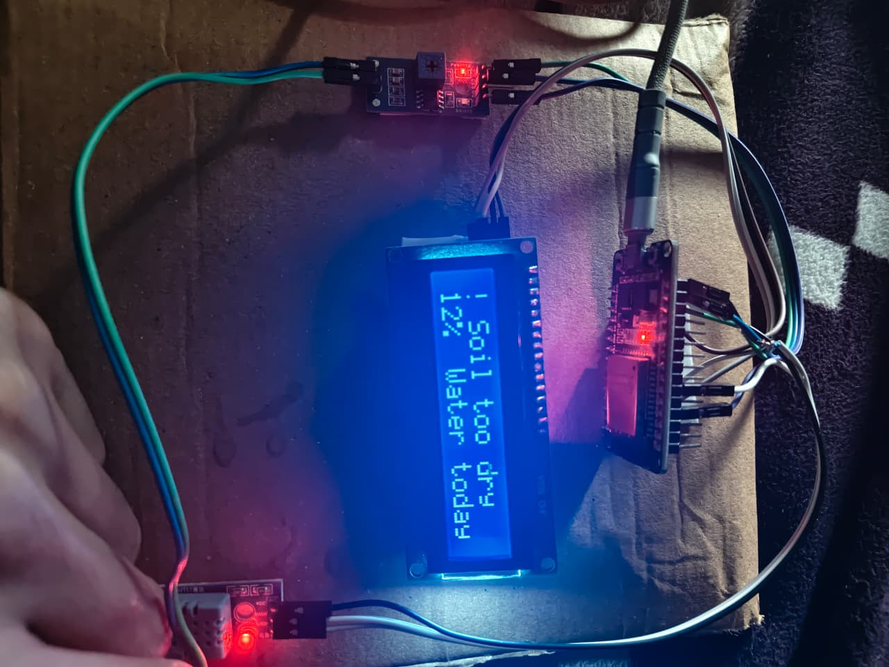<br>
  <em>Live ESP32 Field Node Bench Rig: Soil Moisture Probe (GPIO 34), DHT11 Sensor (GPIO 32), and 16×2 I2C LCD displaying real-time moisture alerts (<code>! Soil too dry · 12% Water today</code>) alongside rotating Air Temp/Humidity (<code>PAGE_CLIMATE</code>) and PHI views.</em>
</p>

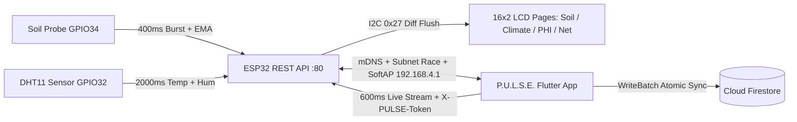

---

## 🎨 Design System, Typography & Color Palette

The visual identity of P.U.L.S.E. reflects a grounded, natural ecological aesthetic inspired by lush flora, rich soil, and organic forest canopies.

### 1. Color Palette Tokens (`lib/theme/app_theme.dart`)

```
   #1E4D2B         #173D22         #3E8E3A         #7CB342         #E3EDD6         #FAF6EC         #FFFDF7
  ┌───────────────┬───────────────┬───────────────┬───────────────┬───────────────┬───────────────┬───────────────┐
  │  AppColors.   │  AppColors.   │  AppColors.   │  AppColors.   │  AppColors.   │  AppColors.   │  AppColors.   │
  │    forest     │  forestDark   │     leaf      │   leafLight   │     sage      │     cream     │     card      │
  │  (Headers/Nav)│  (Buttons)    │ (Gauges/Bars) │  (Highlights) │  (Chips/Soft) │ (Background)  │(Card Surface) │
  └───────────────┴───────────────┴───────────────┴───────────────┴───────────────┴───────────────┴───────────────┘
   #1F2A1F         #5C6B5C         #F4C542         #C62828         #FDECEA         #CFDDBF
  ┌───────────────┬───────────────┬───────────────┬───────────────┬───────────────┬───────────────┐
  │  AppColors.   │  AppColors.   │  AppColors.   │  AppColors.   │  AppColors.   │  AppColors.   │
  │      ink      │     muted     │     honey     │     alert     │   alertSoft   │  sageBorder   │
  │  (Body Text)  │ (Secondary)   │ (Yellow/Dots) │ (Error/Alert) │ (Alert Panels)│(Card Outlines)│
  └───────────────┴───────────────┴───────────────┴───────────────┴───────────────┴───────────────┘
```

| Token | Hex Value | Semantic Role in UI |
| :--- | :--- | :--- |
| `AppColors.forest` | `#1E4D2B` | Brand primary, bottom navigation bar, headers, accent icons, splash gradient start |
| `AppColors.forestDark` | `#173D22` | Primary button fill, elevated CTAs, splash gradient end, strong selection chips |
| `AppColors.leaf` | `#3E8E3A` | Positive health indicator, gauge arcs, linear progress indicators, trend up icon |
| `AppColors.leafLight` | `#7CB342` | Secondary accent, tier ENHANCE badge, floral indicators |
| `AppColors.sage` | `#E3EDD6` | Background tint for chips, soft informational panels, icon circular backgrounds |
| `AppColors.sageBorder` | `#CFDDBF` | Card outlines (1px), divider lines, field input borders |
| `AppColors.cream` | `#FAF6EC` | Universal scaffold background, warm organic canvas replacing harsh cold whites |
| `AppColors.card` | `#FFFDF7` | Elevated card surfaces, modal bottom sheets, dialog backgrounds |
| `AppColors.ink` | `#1F2A1F` | High-contrast body text, primary values, data metrics, field inputs |
| `AppColors.muted` | `#5C6B5C` | Secondary captions, timestamps, helper descriptions, empty state text |
| `AppColors.honey` | `#F4C542` | Yellow alert dots, unread notification badges, gauge middle zones |
| `AppColors.alert` | `#C62828` | High-risk alert banners, chemical warning badges, validation error borders |
| `AppColors.alertSoft` | `#FDECEA` | High-risk alert panel backgrounds, critical notice containers |

### 2. PHI Ecological Tier Color Spectrum

| Tier | Score Range | Hex Color | Category Name | Action Directive |
| :---: | :---: | :---: | :--- | :--- |
| **PROTECT** | **80 – 100** | `#2E7D32` | Pollinator Paradise | Maintain excellent habitat and share practices with neighbors |
| **ENHANCE** | **60 – 79** | `#7CB342` | Pollinator Potential | Add targeted habitat features and increase biodiversity |
| **IMPROVE** | **40 – 59** | `#F9A825` | Pollinator Recovery Zone | Address the weakest ecological factors (flowers, water, shelter) |
| **RESTORE** | **20 – 39** | `#EF6C00` | Pollinator Rescue Mission | High-impact intervention: install native flowers and water sources |
| **INVESTIGATE**| **0 – 19** | `#C62828` | Pollinator Emergency Audit | Investigate acute local threats (pesticide drift, pollution, mowing) |

### 3. Typography & Design Tokens

- **Display & Headings:** `GoogleFonts.lora()` (Serif, weights 600 & 700). Evokes scientific journals, botanical publications, and trustworthy conservation literature.
- **Body & Data:** `GoogleFonts.inter()` (Sans-Serif, weights 400, 500, 600, 700). Engineered for numeric clarity, tabular figures (`FontFeature.tabularFigures()`), form legibility, and compact chip readability.
- **Corner Radii (`AppRadius`):**
  - Cards & Containers: `20.0 dp`
  - Chips & Badges: `12.0 dp`
  - Buttons & CTAs: `28.0 dp` (Full stadium pill)
- **Haptic & Motion Feedback:**
  - `PressableScale`: Smooth interactive scale depression (`0.97` factor over `120 ms`) on all primary buttons and interactive cards.
  - `HapticFeedback.selectionClick()` on toggle chips, segmented choices, and stepper transitions.
  - `HapticFeedback.vibrate()` upon observation timer completion.

---

## 🔄 User Flow & System Architecture

### Authentication & Onboarding Flow

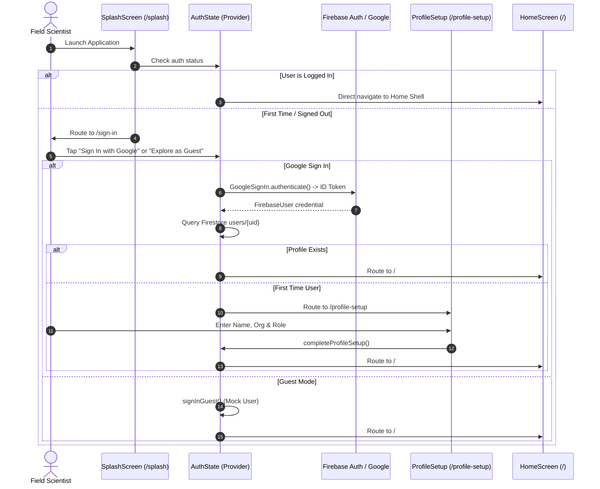

### Main Application Shell Navigation

The application uses `go_router` with a root `StatefulShellRoute.indexedStack`. This architecture guarantees that each tab maintains its own independent widget hierarchy and scroll state:

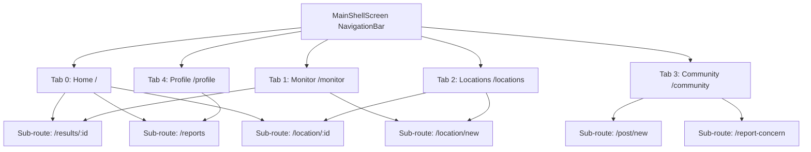

### Field Assessment Lifecycle & Autosave Flow

```mermaid
flowchart LR
    Start([Tap Start Assessment]) --> Step0[Pick Location & Autosave Draft]
    Step0 --> Step1[Step 1: Activity & Timer]
    Step1 --> Step2[Step 2: Habitat & AI Vision]
    Step2 --> Step3[Step 3: Environmental Microclimate]
    Step3 --> Step4[Step 4: Chemical Risk Evaluation]
    Step4 --> Step5[Step 5: Review & PHI Live Preview]
    Step5 --> Submit{Tap Calculate PHI}
    Submit -->|Valid| Batch[Atomic Firestore WriteBatch]
    Batch --> Results[/results/:id]
```

---

## 📱 Exhaustive Screen-by-Screen Breakdown

### 1. Splash Screen (`/splash`)
- **Route:** `/splash` (Top-level parent navigator).
- **Visual Design:** Full-screen vertical gradient (`#24573A` $\rightarrow$ `#173D22`) featuring a central faint radial halo (`white @ 6% opacity`, radius $220\text{ dp}$).
- **Components & Widgets:**
  - `logo_badge.png` ($112 \times 112\text{ dp}$) centered with soft drop shadow (`blurRadius: 24`, `y: 8`).
  - Breathing animation controller: scales $1.0 \rightarrow 1.04 \rightarrow 1.0$ over $900\text{ ms}$ using `Curves.easeInOutQuad`.
  - Wordmark (`P.U.L.S.E.`, Lora $30\text{ sp}$, letter spacing $1.5$) and tagline (`Understanding Pollinators. Inspiring Action.`, Inter $14\text{ sp}$, $75\%$ opacity) fading in and translating $+8\text{ dp} \rightarrow 0\text{ dp}$ over $500\text{ ms}$.
  - Delayed honey progress line ($2\text{ px}$ height, $120\text{ px}$ width, `#F4C542`) triggered only if cold initialization exceeds $1.2\text{ seconds}$.
- **Data & Logic:**
  - Removes Android 12 native splash via `FlutterNativeSplash.remove()`.
  - Pre-caches `auth_hero.jpg` and `logo_badge.png` into image memory cache.
  - Subscribes to `AuthState.status`: redirects to `/` if signed in or `/sign-in` if signed out.

---

### 2. Welcome & Sign-In Screen (`/sign-in`)
- **Route:** `/sign-in`.
- **Visual Design:** Adaptable split-view screen with a high-resolution ecological hero photograph (`auth_hero.jpg`) on top and an overlapping rounded cream card sheet (`AppColors.card`, $24\text{ dp}$ top border radius) on bottom.
- **Components & Widgets:**
  - **Ken Burns Hero Animation:** Smooth $14\text{ s}$ repeating zoom ($1.0 \rightarrow 1.03$) on the habitat photograph.
  - **Overlapping Logo Badge:** $84\text{ dp}$ diameter circle badge positioned across the boundary of the hero photo and bottom card sheet with an entry scale overshoot ($0.8 \rightarrow 1.0$).
  - **Value Proposition Carousel:** 3 auto-advancing slides ($4.5\text{ s}$ interval with page indicator dots):
    1. *Measure pollinator health* – Record what you see and get a Pollinator Health Index in minutes.
    2. *Know what to do next* – Get clear, practical steps for your garden, school or society.
    3. *Grow with your community* – Share initiatives, join events and report concerns nearby.
  - **Google Sign-In Button:** Styled with official vector Google `G` logo, forest dark border, loading spinner when authenticating.
  - **Guest / Demo Access Button:** `Explore as Guest (Offline Demo)` allowing field workers to test without cloud credentials.
  - **Interactive Legal Disclaimer:** Clickable RichText launching slide-up modal bottom sheets with full terms and privacy guidelines.
- **Data & Logic:**
  - Calls `AuthState.signInWithGoogle()` or `AuthState.signInGuest()`.
  - Traps and maps OAuth exceptions (`network-request-failed`, `user-disabled`, `clientconfigurationerror`) into clear user-friendly notifications.

<p align="center">
  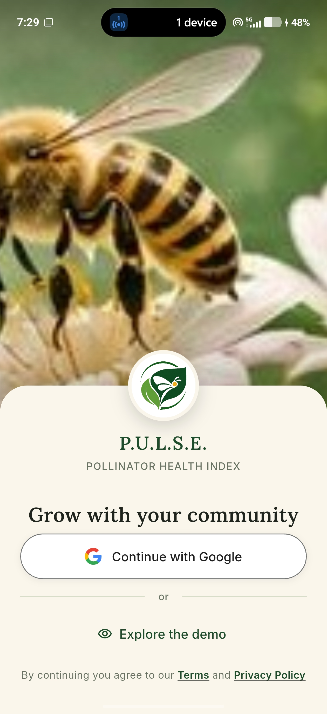<br>
  <em>Welcome & Sign-In Screen (<code>/sign-in</code>) featuring the hero macro photograph, floating brand badge, Google Sign-In, and offline demo access.</em>
</p>

---

### 3. Profile Setup Screen (`/profile-setup`)
- **Route:** `/profile-setup`.
- **Visual Design:** Clean onboarding screen preventing unprofiled users from entering the data ecosystem.
- **Components & Widgets:**
  - Circular avatar container ($84\text{ dp}$) displaying Google account photo or calculated initials.
  - Full Name text field (pre-filled with Google display name).
  - Organisation text field (optional, e.g. "Green Earth Foundation").
  - Role selection wrap chips: `Individual`, `School`, `Residential Society`, `NGO`, `Municipal`, `Expert`.
  - Stadium "Continue" button saving the profile to Firestore (`users/{uid}`).
- **Data & Logic:**
  - Calls `AuthState.completeProfileSetup(name, organisation)`.
  - Updates Firestore document and refreshes router guards to unlock the main application shell.

---

### 4. Main Shell & Persistent Navigation (`MainShellScreen`)
- **Route:** Stateful indexed shell holding branches 0 through 4.
- **Visual Design:** Forest green bottom `NavigationBar` with subtle indicator pill and floating sync badge.
- **Components & Widgets:**
  - 5 Destinations:
    1. **Home** (`Icons.home_outlined` / `Icons.home_rounded`)
    2. **Monitor** (`Icons.bar_chart_outlined` / `Icons.bar_chart_rounded`)
    3. **Locations** (`Icons.location_on_outlined` / `Icons.location_on_rounded`)
    4. **Community** (`Icons.people_outline_rounded` / `Icons.people_rounded`)
    5. **Profile** (`Icons.person_outline_rounded` / `Icons.person_rounded`)
  - `SyncIndicator`: Floating badge in top right corner showing real-time Firestore persistence state:
    - 🟢 *Saved* (Synced to cloud)
    - 🟡 *Syncing...* (Active network write in progress)
    - ⚪ *Offline* (Cached locally in SQLite/Firestore offline cache)

---

### 5. Home Dashboard (`/`)
- **Route:** `/` (Tab index 0).
- **Visual Design:** Dynamic ecological command center combining microclimate conditions, site overviews, and quick action cards.
- **Components & Widgets:**
  - **HomeHeader:** Collapsible sliver app bar with time-based greeting (*"Good morning/afternoon/evening, {Name}!"*), formatted date, brand logo, notification bell with yellow unread badge, and profile avatar shortcut.
  - **2x2 StatTile Grid:**
    - *Total Locations* (Count of registered monitoring sites)
    - *Total Assessments* (Total submitted surveys)
    - *Average PHI* (Mean score across all monitored locations)
    - *Community Members* (Distinct contributing authors in the ecosystem)
  - **Assessment CTA Banner:** High-contrast forest green gradient banner with call to action to launch an assessment.
  - **Your Locations Reel:** Horizontal scrolling carousel of registered sites displaying cover photos, typology, address, and latest PHI tier chips (`ScoreChip`).
  - **HealthSummaryCard:**
    - Animated `RingGauge` showing overall average PHI.
    - Tier status badge (e.g. `PROTECT`, `IMPROVE`).
    - Longitudinal delta indicator (e.g. `▲ 4 since last assessment`).
    - 5-Tier dot color legend.
    - Link to Reports & Analytics.
  - **The Four Parameters Card:** Compact progress list displaying normalized sub-scores for Activity (30%), Habitat (30%), Environment (20%), and Risks (20%).
  - **ActivityTimeline:** Chronological feed of recent assessments and registrations.
  - **CommunityHighlight:** Event card displaying upcoming ecological workshops with date badge or latest community initiative.
  - **QuickActions:** Fast 1-tap shortcuts to register a location, record an observation, or report an urgent concern.
- **Data & Logic:**
  - Pulls from `ApiService.getLocations()`, `getAssessments()`, and `getPosts()`.
  - Re-computes real-time averages across all user-managed locations on pull-to-refresh.

<div align="center">
  <table>
    <tr>
      <td align="center">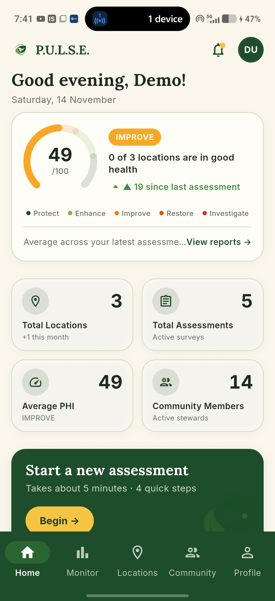</td>
      <td align="center">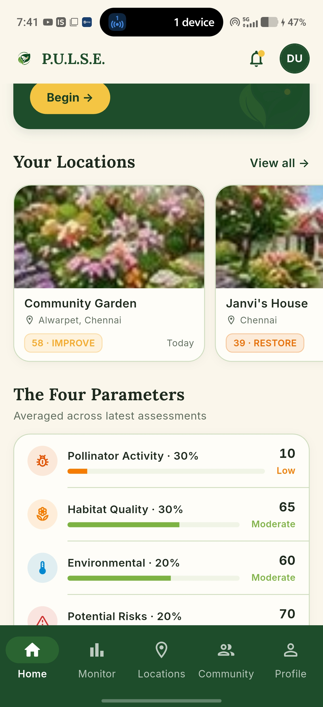</td>
    </tr>
    <tr>
      <td align="center"><strong>PHI RingGauge, 5-Tier Legend &amp; KPI Grid</strong></td>
      <td align="center"><strong>Site Carousel &amp; Four Weighted Parameters</strong></td>
    </tr>
  </table>
</div>

---

### 6. Monitor / New Assessment Stepper (`/monitor`)
- **Route:** `/monitor` (Tab index 1). Accepts optional `?locationId=xyz` query parameter.
- **Visual Design:** Multi-step wizard with persistent location header, 5-segment progress bar, interactive inputs, and automatic draft restoration.
- **Step Components & Scientific Workflows:**

#### Step 1: Pollinator Activity
- **LocationPickerCard:** Dropdown card to select an existing site or tap `+ Add new location`.
- **Visits Counter:** Numeric visits count with `+` and `-` buttons supporting long-press auto-increment, and direct manual dialog input ($0\text{--}500$ visits).
- **Integrated Observation Timer:** Built-in countdown timer ($5, 10, 15, 20, 30\text{ min}$) allowing field scientists to record live visits while watching a $2\text{m} \times 2\text{m}$ quadrat. Vibrates on completion.
- **Observation Metadata:** Date and time picker (defaults to observation moment), duration dropdown, weather condition selector (`Sunny`, `Partly cloudy`, `Cloudy`, `Windy`, `Light rain`, `Rain`).
- **Activity Photo Upload:** Capture up to 5 field photographs with remove thumbnails.
- **Observation Protocol Tip:** Collapsible guideline explaining standardized 5-minute sampling methods. Soft warning triggers if monitoring occurs outside optimal 10–11 AM hours or in rainy/windy weather.

#### Step 2: Habitat Quality
- **Segmented Floral & Nesting Evaluation:** Three 3-state segmented buttons (Low / Medium / High, initially unselected):
  - *Flowers:* Availability of nectar and pollen flora.
  - *Nesting Spaces:* Presence of bare soil, bee hotels, hollow stems, dead wood.
  - *Shelter:* Dense hedgerows, shrubs, leaf litter, and windbreaks.
- **Water Source Segment:** 2-state segmented button (Absent / Present).
- **✨ Gemini AI Vision Integration:**
  - Tapping *"Analyse photos with AI"* sends activity photos to Google Gemini 3.8 Flash.
  - Validates genuine habitat imagery (flags selfies, pets, cars, indoor photos).
  - Generates 1-tap suggestions with confidence ratings (e.g. `AI suggests Flowers: High (85%) · Apply`).

#### Step 3: Environmental Microclimate, Live DHT11 & Soil Moisture
- **Automatic DHT11 Temperature & Humidity Sync (`GPIO 32`):**
  - When a paired ESP32 node with a connected DHT11 sensor is online, **Temperature ($^\circ\text{C}$)** and **Humidity ($\%$)** auto-populate at `600 ms` UI cadence with **`Live DHT11 · XXXX`** badges, feeding directly into the live PHI preview and **Environmental Score**.
  - Typing any custom value gracefully pauses auto-sync (`climateSource: 'manual'`), while a 1-tap **"Use live DHT11"** action restores hardware tracking anytime; if the DHT11 wire is absent, a soft GPIO 32 notice prompts manual fallback.
- **Microclimate Numeric Inputs:**
  - Temperature ($-20^\circ\text{C}$ to $60^\circ\text{C}$)
  - Relative Humidity ($0\%$ to $100\%$)
  - Ambient $\text{CO}_2$ ($0$ to $10,000\text{ ppm}$) with soft validation hint below $300\text{ ppm}$
- **Soil Sensor Panel (`SoilSensorPanel` — Optional 4th Parameter):**
  - Streams live soil moisture ($0\text{--}100\%$, raw ADC, status bar) at `600 ms` intervals when an ESP32 node is paired, with 1-tap **"Use sensor reading"** capture and GPS geotagging.
  - Graceful fallback to manual percentage input when offline or unpaired, plus probe-fault alerts (`Check A0 -> GPIO 34`).
- **Live Status Chips:** Instant real-time evaluation chips (`Suitable` / `Moderate` / `Stressful`) rendered beneath each field once valid numbers are entered.
- **Info Sheet:** Explains prototype scoring ranges and biological relevance.

#### Step 4: Potential Risks & Contaminants
- **Risk Indicator Checkboxes:** 4 checkboxes for observed stressors:
  1. Nearby pesticide spraying
  2. Nearby chemical use
  3. Heavy traffic or industrial emissions
  4. Other site-specific concerns
- **Risk Level Dropdown:** User selects Low, Moderate, or High risk.
- **Intelligent Heuristic Suggestion:** Form analyzes selected indicators and suggests: *"Based on your selections we suggest: High"*.
- **Field Details:** Description text field, approximate date observed, notes, and risk photo uploader.
- **Scientific Clarification Footnote:** Explicitly declares that P.U.L.S.E. logs risk indicators and does not constitute laboratory chemical assay.

#### Step 5: Review & PHI Calculation Preview
- **Live Preview Gauge:** Real-time animated `RingGauge` previewing the calculated score before cloud commit.
- **Sub-score Mini Badges:** Live cards displaying Activity, Habitat, Environment, and Risk scores.
- **Section Summary Cards:** Individual recap cards for Steps 1–4 (including captured soil moisture and DHT11 temperature/humidity provenance with device ID and timestamp) with thumbnail previews and direct "Edit" jump links.
- **Completeness Guard:** Displays `"N Required Fields Remaining"` if incomplete.
- **Calculate PHI Button:** Disabled until 100% complete. On submit, shows a leaf animation, commits an atomic transaction to Firestore, pushes the latest PHI summary to the paired ESP32 LCD, and routes to Results.

<div align="center">
  <table>
    <tr>
      <td align="center">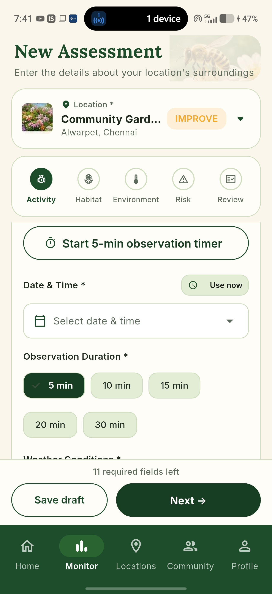</td>
      <td align="center">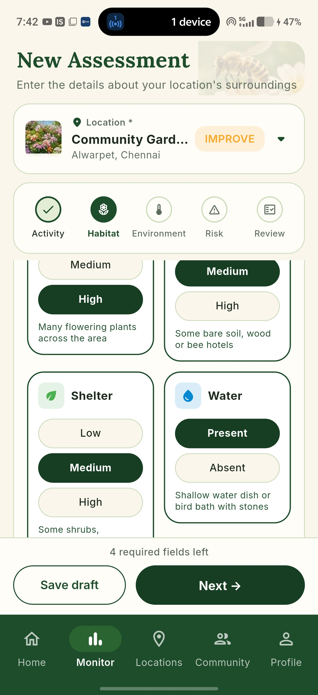</td>
      <td align="center">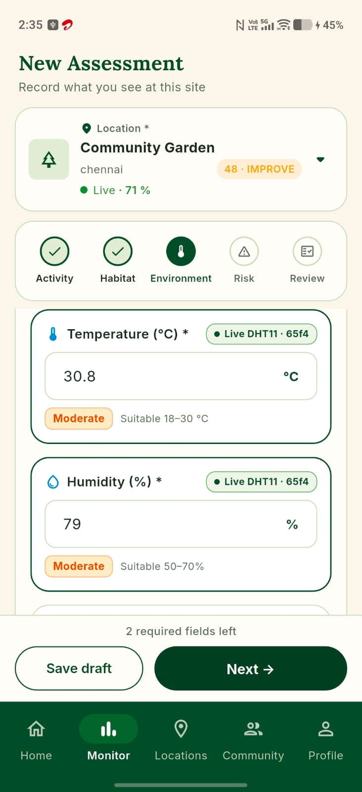</td>
    </tr>
    <tr>
      <td align="center"><strong>Step 1: Activity &amp; 5-Min Timer</strong></td>
      <td align="center"><strong>Step 2: Habitat Quality</strong></td>
      <td align="center"><strong>Step 3: Live DHT11 &amp; Soil Sync</strong></td>
    </tr>
    <tr>
      <td align="center">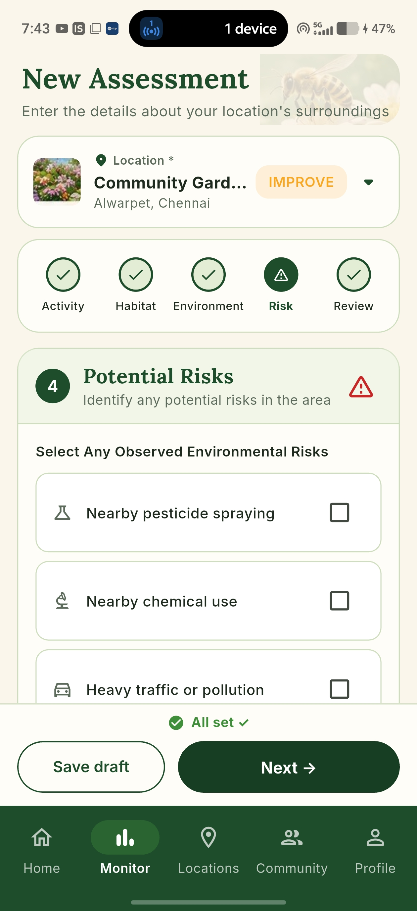</td>
      <td align="center">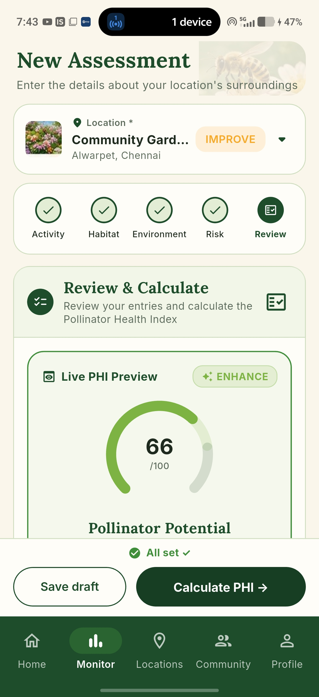</td>
      <td align="center"><em>Hardware reads soil (GPIO 34) + air (DHT11 GPIO 32) automatically into Step 3 before calculating PHI.</em></td>
    </tr>
    <tr>
      <td align="center"><strong>Step 4: Potential Risks</strong></td>
      <td align="center"><strong>Step 5: Live PHI Preview</strong></td>
      <td align="center"></td>
    </tr>
  </table>
</div>

---

### 7. Assessment Results & Analytics (`/results/:id`)
- **Route:** `/results/:id`.
- **Visual Design:** Editorial presentation celebrating ecological success or providing high-priority restoration directives.
- **Components & Widgets:**
  - **High Risk Alert Banner:** Prominent red warning banner triggered if `highRiskAlert == true`, warning users of acute contamination regardless of overall tier score.
  - **Animated Semicircular PHI Gauge:** Custom painter gauge with 5 colored tier segments, sweeping arc ($1.2\text{ s}$ easeOutCubic), needle rotation, and score text positioned cleanly beneath the arc.
  - **Tier Badge & Category Name:** Displays ecological classification (e.g. `PROTECT · Pollinator Paradise`) and recommendation text.
  - **"Why this score?" Card:** Algorithmic explanation detailing exact strengths (e.g. *"high pollinator activity"*) and limiting factors (e.g. *"limited water sources"*).
  - **The Four Parameter Cards (2x2 Grid):**
    - Parameter name & official weight ($30\%, 30\%, 20\%, 20\%$)
    - Sub-score out of 100 (`formatSubScore`)
    - Unified status chip (`Good`, `Fair`, `Moderate`, `Low`, `Critical`)
    - Detail metrics (e.g. *"18 visits in 5 min"*, *"25°C | 50% hum | 500 ppm CO₂ | Soil 68% (Moist)"*)
    - Animated progress bar and scoring basis footnote.
  - **Mathematical Calculation Expander:** Expandable card showing raw weighted arithmetic: `(90 × 0.30) + (85 × 0.30) + (100 × 0.20) + (90 × 0.20) = 90.5 → 91`.
  - **Ecological Insights Card (Gemini AI):** Displays multimodal summary, photo findings, dedicated **Soil** advisory row (`soilAdvice` when present), and habitat enhancement tips generated by Gemini.
  - **Historical Trend Line Chart (`fl_chart`):** Longitudinal curve showing score progression across previous assessments at this location.
  - **"What to do next?" Checklist:** Prioritized ecological action items with checkmark icons.
  - **"Record an action taken":** Interactive button opening a bottom sheet to record interventions (e.g. *"Planted lavender and installed water dish"*). Actions are appended to the permanent assessment record.
  - **Navigation Buttons:** Equalized stadium footer actions to export/download report or view location details.

<div align="center">
  <table>
    <tr>
      <td align="center">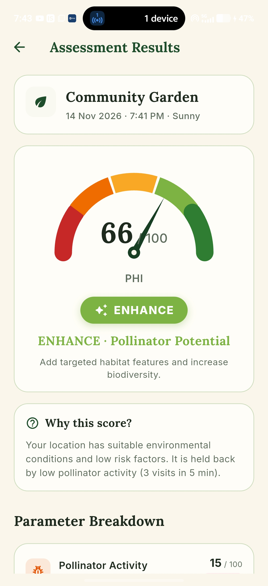</td>
      <td align="center">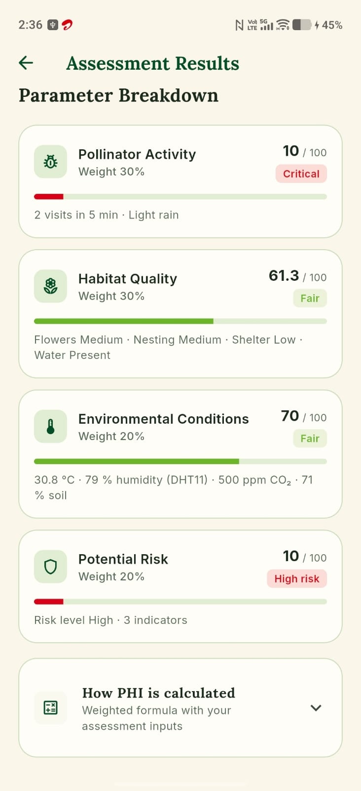</td>
    </tr>
    <tr>
      <td align="center"><strong>Animated PHI Gauge &amp; Score Explanation</strong></td>
      <td align="center"><strong>Four Parameter Cards (Live DHT11 + Soil)</strong></td>
    </tr>
    <tr>
      <td align="center">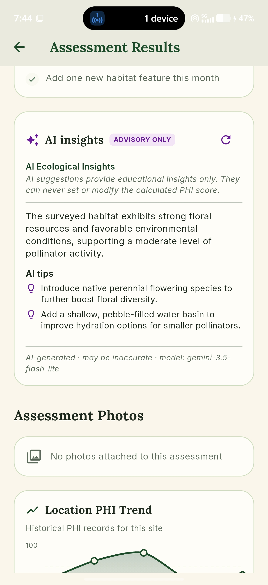</td>
      <td align="center">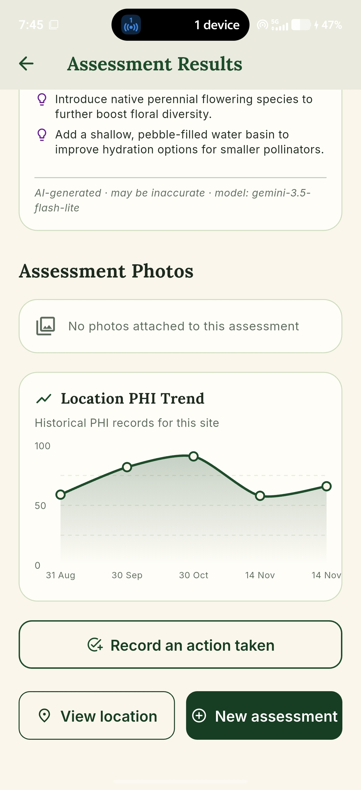</td>
    </tr>
    <tr>
      <td align="center"><strong>Gemini AI Advisory Insights</strong></td>
      <td align="center"><strong>Longitudinal PHI Trend &amp; Interventions</strong></td>
    </tr>
  </table>
</div>

---

### 8. Locations Directory (`/locations`)
- **Route:** `/locations` (Tab index 2).
- **Visual Design:** Clean card directory of all registered pollinator habitats.
- **Components & Widgets:**
  - Site cards displaying photo thumbnail, site title, address/area, latest PHI chip with tier color, and last assessed date.
  - Empty state with guidance when no locations exist.
  - Floating Action Button: `+ Add Location` routing to `/location/new`.

---

### 9. Location Detail View (`/location/:id`)
- **Route:** `/location/:id`.
- **Visual Design:** Comprehensive site profile with historical metrics and quick actions.
- **Components & Widgets:**
  - Hero site photograph, location name, typology badge, and address.
  - Large centered `PhiGauge` representing current health.
  - Direct CTA: *"Start Assessment For This Location"* (pre-selects site in Monitor).
  - Assessment history list and action log.

---

### 10. Register New Location (`/location/new`)
- **Route:** `/location/new`.
- **Visual Design:** Simple registration form.
- **Components & Widgets:**
  - Information Card: *"Why Register a Location?"*.
  - Location Name input.
  - Typology Dropdown (`Home garden`, `Balcony / terrace`, `Community garden`, `School campus`, `Residential society`, `Park`, `Farm`, `Office campus`, `Other`).
  - Address / Area input.
  - GPS Coordinate Capture: Uses `geolocator` to capture latitude and longitude.
  - Photo attachment.
  - Save button writing directly to Firestore (`locations/{id}`).

---

### 11. Community Hub (`/community`)
- **Route:** `/community` (Tab index 3).
- **Visual Design:** Vibrant social feed for collective environmental stewardship.
- **Components & Widgets:**
  - Community Hero Banner (`community_hero.jpg`).
  - **Report a Concern Card:** Prominent amber card linking to incident reporting.
  - **Post Feed:** Cards featuring author avatar, name, organization badge, timestamp, post category tag, title, body text, attached photo, animated like button with counter, and share action.
  - Floating Action Button: `+ New Post`.

---

### 12. Create Community Post (`/post/new`)
- **Route:** `/post/new`.
- **Visual Design:** Content creation form.
- **Components & Widgets:**
  - Title input.
  - Category selector (`Initiative`, `Event`, `Resource`, `Report`, `General`).
  - Content body editor.
  - Optional event details (date, time, venue) when `Event` category is selected.
  - Publish button committing post to Firestore (`posts/{id}`).

---

### 13. Report an Ecological Concern (`/report-concern`)
- **Route:** `/report-concern`.
- **Visual Design:** Formal ecological logging form.
- **Components & Widgets:**
  - Scientific clarification banner (not laboratory analysis).
  - Specific area description.
  - Observed concern checkboxes (pesticides, industrial dumping, habitat clearing).
  - Detailed narrative text field.
  - Photo upload for visual evidence.
  - Submit button writing to Firestore `concerns/{id}`.

---

### 14. Reports & Longitudinal Analytics (`/reports`)
- **Route:** `/reports`.
- **Visual Design:** Comprehensive analytical view for researchers and property managers.
- **Components & Widgets:**
  - Overall historical PHI average gauge.
  - Comparative sub-score performance across assessments.
  - Full chronological assessment archive with date, score, tier chip, and click-through to Results.

---

### 15. Profile & Settings (`/profile`) & Field Sensor Pairing (`/sensor/pair`)
- **Routes:** `/profile` (Tab index 4) and `/sensor/pair`.
- **Visual Design:** User account controls, local AI key configuration, and guided ESP32 hardware setup.
- **Components & Widgets:**
  - User profile card with avatar, name, email, and organisation line.
  - **Field Sensor Card (`FieldSensorSettingsCard`):** Shows active paired ESP32 node status (`Live`, `Connecting`, `Offline`, `Pair again`), two-point dry/wet soil calibration modal, unpair action, and quick launch to `/sensor/pair`.
  - **Sensor Pairing Screen (`/sensor/pair`):** Supports **Same Wi-Fi** (mDNS `_pulse._tcp` + fast TCP/80 hotspot subnet sweep), **Direct to node** (SoftAP `192.168.4.1`), and **Enter Node IP** (from LCD), followed by a 6-digit PIN handshake screen.
  - **Gemini AI Settings Card (SQLite-backed):** API key input stored locally on device, **"Save key"** button, and collapsed technical details expander.
  - Links to Reports & Analytics, About PHI Formula, Privacy Policy, Terms of Service, and Sign Out.

---

## 📐 The Scientific PHI Scoring Engine

The **Pollinator Health Index (PHI)** is an empirical score from **0 to 100** computed using a weighted multi-parameter formula defined in [`lib/core/phi.dart`](lib/core/phi.dart) and [`lib/core/soil.dart`](lib/core/soil.dart):

$$\text{PHI} = \text{Round}\Big(\big(\text{Activity} \times 0.30\big) + \big(\text{Habitat} \times 0.30\big) + \big(\text{Environment} \times 0.20\big) + \big(\text{Risk} \times 0.20\big)\Big)$$

### Mathematical Sub-Score Rules

#### 1. Pollinator Activity ($30\%$ Weight)
Normalizes observed visits to a standard 5-minute sampling window:
$$\text{Visits}_{\text{norm}} = \text{visits} \times \frac{5}{\text{durationMinutes}}$$
$$\text{Activity Score} = \min\left(100.0, \, \frac{\text{Visits}_{\text{norm}}}{20} \times 100\right)$$

#### 2. Habitat Quality ($30\%$ Weight)
Evaluates 4 physical habitat provisions:
- **Flowers:** Low = 25, Medium = 60, High = 90
- **Nesting Spaces:** Low = 25, Medium = 60, High = 90
- **Shelter:** Low = 25, Medium = 60, High = 90
- **Water Source:** Present = 100, Absent = 0
$$\text{Habitat Score} = \frac{\text{Flowers} + \text{Nesting} + \text{Shelter} + \text{Water}}{4}$$

#### 3. Environmental Microclimate & Optional Soil Moisture ($20\%$ Weight)
Combined score across Temperature, Relative Humidity, Ambient $\text{CO}_2$, and optional **Soil Moisture ($S$ in $\%$)** captured from the ESP32 node or manual entry:
- **Temperature ($T$ in $^\circ\text{C}$):**
  - $18 \le T \le 30 \implies 100\text{ pts}$ (Suitable)
  - $15 \le T < 18$ or $30 < T \le 34 \implies 60\text{ pts}$ (Moderate)
  - $T < 15$ or $T > 34 \implies 20\text{ pts}$ (Stressful)
- **Relative Humidity ($H$ in $\%$):**
  - $50 \le H \le 70 \implies 100\text{ pts}$ (Suitable)
  - $35 \le H < 50$ or $70 < H \le 85 \implies 60\text{ pts}$ (Moderate)
  - $H < 35$ or $H > 85 \implies 20\text{ pts}$ (Stressful)
- **$\text{CO}_2$ Concentration ($C$ in $\text{ppm}$):**
  - $C < 800 \implies 100\text{ pts}$ (Suitable)
  - $800 \le C \le 1000 \implies 60\text{ pts}$ (Moderate)
  - $C > 1000 \implies 20\text{ pts}$ (Stressful)
- **Soil Moisture ($S$ in $\%$, optional — `formulaVersion: v1.1-soil`):**
  - $40 \le S \le 60 \implies 100\text{ pts}$ (Optimal / Suitable)
  - $25 \le S < 40$ or $60 < S \le 75 \implies 60\text{ pts}$ (Low / Moist)
  - $S < 25$ or $S > 75 \implies 20\text{ pts}$ (Dry / Waterlogged)
$$\text{Environmental Score} = \begin{cases} \dfrac{\text{Score}_T + \text{Score}_H + \text{Score}_C + \text{Score}_S}{4} & \text{with soil (v1.1-soil)} \\[8pt] \dfrac{\text{Score}_T + \text{Score}_H + \text{Score}_C}{3} & \text{without soil (v1)} \end{cases}$$

#### 4. Potential Risk ($20\%$ Weight)
Evaluated based on observed pesticide use, chemical drift, or traffic:
- **Low Risk:** $90\text{ pts}$
- **Moderate Risk:** $50\text{ pts}$
- **High Risk:** $10\text{ pts}$

---

## 🧠 AI Multimodal Advisory System (Google Gemini)

P.U.L.S.E. integrates **Google Gemini** via `firebase_ai` and a direct REST fallback for real-time ecological support:

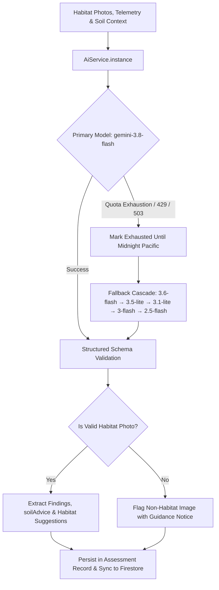

- **Structured Output:** Strictly enforced through JSON schemas (`isHabitatPhoto`, `summary`, `photoFindings`, `suggestions`, `habitatSuggestions`, `soilAdvice`).
- **Context-Aware Soil Advisory:** Injects soil moisture readings into the Gemini prompt only when soil data is recorded, preventing hallucinated moisture advice on non-sensor surveys.
- **Quota Resilience & Score Invariance:** Automatically caches exhausted models until midnight Pacific Time and generates advisory text without altering deterministic PHI calculations.

---

## 🔒 Backend Architecture & Cloud Ecosystem

### Authentication Workflows
- **Google Sign-In v7:** Uses server client ID authentication to obtain ID tokens and exchange them with Firebase Auth.
- **Email & Password:** Standard registration and login via Firebase Auth.
- **Guest / Demo Mode:** Provides instant, local, offline access without requiring internet or credentials.
- **First-Time Setup Guard:** Routes users to `/profile-setup` before granting access to the main shell.

### Cloud Firestore Schema & Subcollections

```
firestore/
├── users/
│   └── {uid}                      # AppUser document (name, email, organisation, role)
├── locations/
│   └── {locationId}               # Location document (name, coordinates, sensorNodeId, latestPhi, lastAssessedAt)
├── assessments/
│   └── {assessmentId}             # Assessment document (inputs, optional soil, result, ai, status)
│       ├── photos/
│       │   └── {photoId}          # Compressed thumbnails (480px JPEG in base64)
│       └── actions/
│           └── {actionId}         # Actions taken by the user (date, notes)
├── devices/
│   └── {deviceId}                 # Paired hardware metadata (ownerUid, model, fw; NO tokens/secrets)
├── posts/
│   └── {postId}                   # Community posts (author, category, body, event data)
│       ├── likes/
│       │   └── {uid}              # User like markers
│       └── reports/
│           └── {uid}              # User report markers (reasons)
└── concerns/
    └── {concernId}                # Reported ecological concerns
```

### Cloud Security Rules (`firestore.rules` & `storage.rules`)
- **Strict User Ownership:** Documents in `users`, `locations`, `assessments`, `devices`, and `concerns` require `request.auth.uid == resource.data.ownerUid`.
- **Submission Immutability & Allow-Lists:** Once an assessment is `submitted`, scores and inputs are locked (`ai` and `actionsTaken` updates allowed).
- **Compact Schema Validators (`< 1,000` expressions):** `isValidUser`, `isValidLocation`, `isValidAssessment`, `isValidSoil` (`isValidSoilCore` + `isValidSoilTelemetry`), `isValidDevice` (explicitly blocking `token`/`secret`/`pairingToken`/`wifiPassword`), `isValidPost`, and `isValidConcern`. See [`docs/FIRESTORE_RULES_DIFF.md`](docs/FIRESTORE_RULES_DIFF.md).

### Offline-First Hybrid Synchronization & Local SQLite
- **SQLite (`sqflite` v2):** Stores paired `sensor_nodes` (host, port, bearer token, calibration `dryRaw`/`wetRaw`, last seen timestamp) and local Gemini API keys on-device only.
- **Firestore Offline Persistence:** Automatic offline caching paired with `SyncIndicator` status updates (`Saved`, `Syncing...`, `Offline`).
- **Thumbnail Compression:** Compresses field photos (`480 px` JPEG at quality `60`) as base64 thumbnails for Spark-plan multi-device sync.

---

## 📸 Application Ecosystem Gallery

Real high-resolution captures of the workspace tabs complementing the [Hardware Bench](#-esp32-iot-hardware-node--firmware), [Onboarding & Home](#2-welcome--sign-in-screen-sign-in), [5-Step Assessment](#step-1-pollinator-activity), and [Results & AI Insights](#7-assessment-results--analytics-resultsid) sections above:

<div align="center">
  <table>
    <tr>
      <td align="center">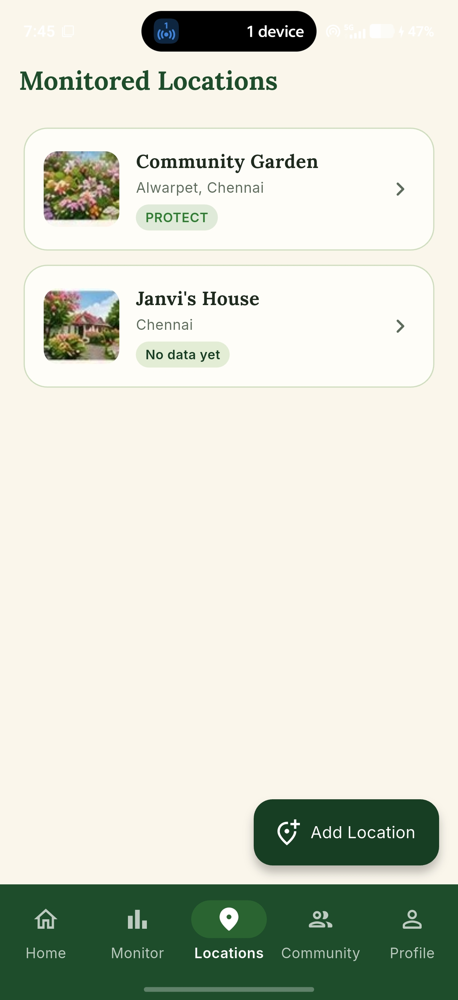</td>
      <td align="center">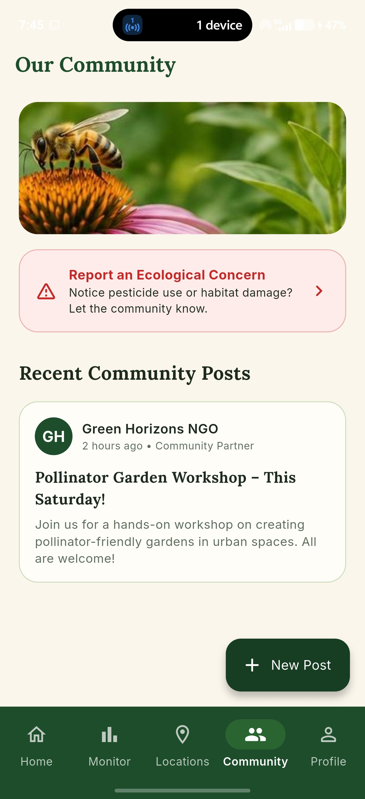</td>
      <td align="center">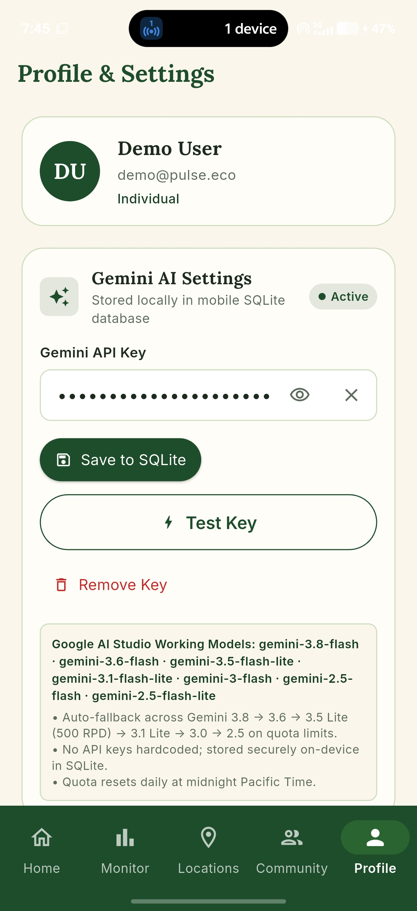</td>
    </tr>
    <tr>
      <td align="center"><strong>Monitored Locations (<code>/locations</code>)</strong></td>
      <td align="center"><strong>Community Hub (<code>/community</code>)</strong></td>
      <td align="center"><strong>Profile &amp; SQLite AI Settings (<code>/profile</code>)</strong></td>
    </tr>
  </table>
</div>

---

## 🚀 Setup & Execution Guide (App + Firmware)

### Prerequisites
- [Flutter SDK](https://docs.flutter.dev/get-started/install) (`^3.12.2` or higher) & Dart (`^3.12.2`)
- Android Studio / VS Code & Android SDK Platform 34+
- [PlatformIO CLI](https://platformio.org/) (for flashing ESP32 firmware)
- [Firebase CLI](https://firebase.google.com/docs/cli) (for deploying `firestore.rules` & indexes)

### Mobile App Installation & Run

```bash
# 1. Clone the repository
git clone https://github.com/your-username/pulse.git
cd pulse

# 2. Install Flutter dependencies
flutter pub get

# 3. Verify toolchain
flutter doctor

# 4. Run application on connected Android device/emulator
flutter run

# 5. Build optimized standalone release APK
flutter build apk --release
```

### ESP32 Sensor Node Firmware Flash

```bash
# Navigate to PlatformIO firmware project
cd firmware/pulse_node

# Build and upload to connected ESP32 (replace COM5 with your serial port)
pio run -t upload --upload-port COM5

# Optional: inspect boot logs and LCD self-test verification
pio device monitor --baud 115200
```

### Deploy Firestore Rules & Indexes

```bash
firebase deploy --only firestore --project pulse-app-849c6
```

---

## 🧪 Testing & Quality Assurance

P.U.L.S.E. maintains a fully automated suite of **144 passing unit and widget tests** alongside **0 analyzer issues**:

```bash
flutter analyze lib test
flutter test
```

### Test Suite Breakdown
- **Core PHI & Soil Scoring (`test/phi_test.dart`, `test/soil_phi_test.dart`):** Tier boundaries, normalization math, temperature/humidity/$\text{CO}_2$/soil cutoffs, `v1` vs `v1.1-soil` weighting, and rounding invariance.
- **Hardware Layer (`test/hardware/`):** `SensorNodeClient` HTTP error & DHT11 payload parsing, `SensorDiscovery` mDNS/SoftAP/IP validation, SQLite v2 `sensor_nodes` migrations, and `SensorNodeController` state machine polling/capture.
- **Hardware UI Widgets (`test/widgets/sensor/`):** `SoilSensorPanel`, `Step3Environment` DHT11 live auto-sync & manual override (`step3_dht11_test.dart`), `SensorStatusButton`, `FieldSensorCard`, and Step 5 / Results integration across `360 dp` and `1.3×` text scale.
- **UI Audit Verification (`test/phase_5_ui_audit_test.dart`):** Automated regressions for UI audit items (gauge layout, unified sub-score bands, tier badges, locations screen data).
- **AI & Firestore (`test/ai_service_test.dart`, `test/ai_service_soil_test.dart`, `test/firestore_api_service_test.dart`):** Gemini fallback cascade, `soilAdvice` schema & parsing, score invariance, and Firestore draft/submit batch flows.
- **End-to-End Screens (`test/monitor_screen_test.dart`, `test/home_redesign_test.dart`, `test/results_screen_test.dart`, `test/widget_test.dart`):** 5-step assessment flow, observation timer, Home dashboard gauges, and Results charts.

---

## 📜 License

Distributed under the **MIT License**. See [`LICENSE`](LICENSE) for more information.

<p align="center">
  Built with 💚 for pollinators everywhere.
</p>
