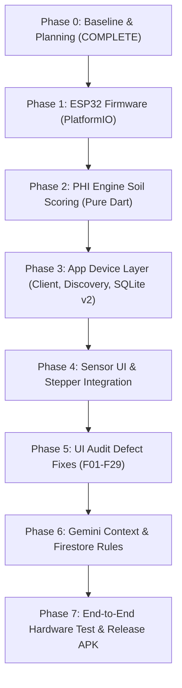

# P.U.L.S.E. — Hardware Integration & Audit Implementation Plan

> **Phase 0 Baseline & Codebase Mapping Artifact**
> **Date:** November 2026  
> **Status:** Baseline Green (93/93 tests passing, 0 analyzer issues in `lib/` and `test/`)  
> **Hardware Status:** ESP32 Verified on `COM5` (Silicon Labs CP210x, VID:PID `10C4:EA60`)

---

## 1. Executive Summary & Verification

In accordance with [00_MASTER_CONTEXT_PROMPT.md](file:///c:/projects/pulse/00_MASTER_CONTEXT_PROMPT.md), [IMPLEMENTATION_PLAN.md](file:///c:/projects/pulse/IMPLEMENTATION_PLAN.md), [HARDWARE_INTEGRATION.md](file:///c:/projects/pulse/docs/HARDWARE_INTEGRATION.md), and [UI_AUDIT.md](file:///c:/projects/pulse/UI_AUDIT.md), this artifact maps every phase to existing files, documents hardware status on `COM5`, records baseline metrics, and identifies code-to-plan variances.

### 1.1 Baseline Validation Results

- **`flutter test` Baseline:** **93 tests passed, 0 failures, 0 skipped** across all 7 test suites:
  - `test/ai_service_test.dart`: **12 tests** (model cascade, fallback, quota exhaustion, json schema)
  - `test/firestore_api_service_test.dart`: **5 tests** (configuration, sync status, draft validation, submit logic)
  - `test/home_redesign_test.dart`: **10 tests** (RingGauge, HealthSummaryCard, StatTile, AssessmentCTA, ParametersCard, QuickActionsRow, ActivityTimeline, HomeLocationCard)
  - `test/monitor_screen_test.dart`: **5 tests** (header/stepper rendering, Step 1 activity, 5-step E2E flow, 360px layout, observation timer)
  - `test/phi_test.dart`: **47 tests** (Community Garden brief, tier boundaries, rounding half-up, sub-scores, recommendations)
  - `test/results_screen_test.dart`: **9 tests** (math verification, gauge, parameter breakdown, calculation expander, recommendations, risk alerts, empty state)
  - `test/widget_test.dart`: **5 tests** (PhiGauge, ScoreChip, TierBadge, PulseCard/PressableScale, ParameterCard)
- **`flutter analyze lib test` Baseline:** **0 issues found** (Clean).

### 1.2 Hardware & Serial Port Status (COM5)

- **Device Name:** `Silicon Labs CP210x USB to UART Bridge (COM5)`
- **Device ID:** `USB\VID_10C4&PID_EA60\0001`
- **Port:** `COM5`
- **Active Status:** Hardware is physically connected to the host machine.
- **Tools Available:**
  - PlatformIO CLI (`pio.exe`) installed at `C:\Users\Veera\AppData\Local\Programs\Python\Python312\Scripts\pio.exe`.
  - Python 3.12 runtime available.
  - Arduino IDE / serial-monitor background process verified.
- **Hardware Architecture Mapping:**
  - **Soil Probe:** LM393 resistive probe on ESP32 ADC1 pin **GPIO 34** (ADC1 input-only, safe while Wi-Fi is active).
  - **16x2 I2C LCD:** PCF8574 backpack on **SDA: GPIO 21**, **SCL: GPIO 22**, 5V VIN.
  - **User Button:** BOOT button on **GPIO 0**.
  - **No DHT22:** Temperature, humidity, and CO₂ remain manual inputs.

```
┌──────────────── ESP32 node (COM5) ──────────────┐         ┌──────────────── Flutter app ──────────────────┐
│ Soil probe ─ADC1(GPIO34)─▶ soil_sensor          │         │ SensorDiscovery (mDNS / SoftAP / manual IP)   │
│   32x sample · trimmed mean · EMA · %           │  HTTP   │ SensorNodeClient (token, timeouts)            │
│   status DRY/LOW/OPTIMAL/MOIST/WET              │◀──────▶│ SensorNodeController (ChangeNotifier)         │
│ api (WebServer :80, JSON, X-PULSE-Token)        │  JSON   │   poll 3 s while visible · capture · pushPhi  │
│ net (WiFiManager, AP+STA, mDNS, NTP)            │         │ SQLite sensor_nodes (token stays local)       │
│ lcd_ui (16x2, frame buffer, differential write) │         │ phi.dart + soil.dart  ──▶  PhiResult          │
│ store (NVS: calibration, token, PHI history)    │         │ AiService (+ soil context, soilAdvice)        │
└─────────────────────────────────────────────────┘         │ Firestore: assessments.soil, devices/{id}     │
                                                            └───────────────────────────────────────────────┘
```

---

## 2. Codebase Mapping to Existing Files

| Architecture Component | Codebase File Path | Key Classes / Functions / Details |
|---|---|---|
| **PHI Scoring Engine** | [`lib/core/phi.dart`](file:///c:/projects/pulse/lib/core/phi.dart) | `calculatePhi(AssessmentInputs)`, `PhiResult`, `AssessmentInputs`, `temperatureScore`, `humidityScore`, `co2Score`, `habitatScore`, `activityScore`, `riskScore`, `roundHalfUp`, `tierFor` |
| **Recommendations & Text** | [`lib/core/recommendations.dart`](file:///c:/projects/pulse/lib/core/recommendations.dart) | `explainScore`, `nextSteps`, `tierInfo`, `activityLabel`, `habitatLabel`, `environmentLabel`, `riskLabel` |
| **Data Models** | [`lib/models/models.dart`](file:///c:/projects/pulse/lib/models/models.dart) | `Assessment` (draft & submitted), `Location`, `AppUser`, `AiInsight`, `HabitatSuggestion`, `Post`, `ConcernReport` |
| **Monitor Stepper Screen** | [`lib/screens/monitor/monitor_screen.dart`](file:///c:/projects/pulse/lib/screens/monitor/monitor_screen.dart) | 5 steps controller (`_pageController`), `_scheduleAutosave()` (lines 150-159), `_saveDraftExplicitly()`, completeness guard (`remainingFieldsCount == 0 ? 'All set ✓' : '$remainingFieldsCount required fields left'` at lines 697-721) |
| **Monitor Step 1 (Activity)** | [`lib/screens/monitor/widgets/step1_activity.dart`](file:///c:/projects/pulse/lib/screens/monitor/widgets/step1_activity.dart) | Visits counter, duration chips, weather chips, observation timer, photo upload |
| **Monitor Step 2 (Habitat)** | [`lib/screens/monitor/widgets/step2_habitat.dart`](file:///c:/projects/pulse/lib/screens/monitor/widgets/step2_habitat.dart) | Flowers, nesting, shelter chips, water toggle, AI photo suggestion chips |
| **Monitor Step 3 (Environment)** | [`lib/screens/monitor/widgets/step3_environment.dart`](file:///c:/projects/pulse/lib/screens/monitor/widgets/step3_environment.dart) | Temperature, humidity, CO₂ fields, status chips, Environmental sub-score preview. *(Target insertion point for `SoilSensorPanel`)* |
| **Monitor Step 4 (Risk)** | [`lib/screens/monitor/widgets/step4_risk.dart`](file:///c:/projects/pulse/lib/screens/monitor/widgets/step4_risk.dart) | Risk checkboxes (`RiskIndicators`), Risk Level dropdown, AI suggested risk hint |
| **Monitor Step 5 (Review)** | [`lib/screens/monitor/widgets/step5_review.dart`](file:///c:/projects/pulse/lib/screens/monitor/widgets/step5_review.dart) | Live PHI preview (`calculatePhi`), Environmental summary row, mini score strip |
| **Monitor Supporting Widgets** | `lib/screens/monitor/widgets/` | `location_picker_card.dart`, `stepper_progress_bar.dart`, `step_card_frame.dart`, `shake_wrapper.dart` |
| **Results Screen** | [`lib/screens/results/results_screen.dart`](file:///c:/projects/pulse/lib/screens/results/results_screen.dart) | `PhiGauge` semicircle, `ParameterCard` list, "How PHI is calculated" expander, "Why this score?", "What to do next?" checklist, `_buildAiInsightsCard()`, `fl_chart` trend chart |
| **Home Screen** | [`lib/screens/home/home_screen.dart`](file:///c:/projects/pulse/lib/screens/home/home_screen.dart) | Overview calculation across locations, pull-to-refresh, navigation |
| **Home Screen Widgets** | `lib/screens/home/widgets/` | `home_header.dart` (`HomeHeader`), `health_summary_card.dart` (`HealthSummaryCard`), `stat_tile.dart` (`StatTile`), `parameters_card.dart` (`ParametersCard`), `activity_timeline.dart` (`ActivityTimeline`), `community_highlight.dart` (`CommunityHighlight`), `quick_actions.dart` (`QuickActionsRow`), `assessment_cta.dart` (`AssessmentCtaCard`), `location_card.dart` (`HomeLocationCard`), `ring_gauge.dart` (`RingGauge`) |
| **Locations Tab (List)** | [`lib/screens/locations/locations_screen.dart`](file:///c:/projects/pulse/lib/screens/locations/locations_screen.dart) | Currently static hardcoded list (Root cause of **F01** defect) |
| **Location Detail Screen** | [`lib/screens/locations/location_detail_screen.dart`](file:///c:/projects/pulse/lib/screens/locations/location_detail_screen.dart) | Location metadata, latest PHI, history list, "Start new assessment" |
| **Register Location Screen** | [`lib/screens/locations/register_location_screen.dart`](file:///c:/projects/pulse/lib/screens/locations/register_location_screen.dart) | Name, type, address, geolocator coordinates |
| **Profile Screen** | [`lib/screens/profile/profile_screen.dart`](file:///c:/projects/pulse/lib/screens/profile/profile_screen.dart) | Profile header, Gemini API Settings card with SQLite save/test |
| **Gemini AI Service** | [`lib/ai/ai_service.dart`](file:///c:/projects/pulse/lib/ai/ai_service.dart) | `AiService.instance`, `kAiModels` (2026 priority list), `generateWithFallback`, `kAiInsightSchema`, `kAiInsightRestSchema` |
| **API & Firestore Service** | [`lib/data/firestore_api_service.dart`](file:///c:/projects/pulse/lib/data/firestore_api_service.dart) | `FirestoreApiService`, `submitAssessment` (atomic `WriteBatch` updating assessment and location `latestPhi`), `saveDraft`, `getAssessments` |
| **Local SQLite Helper** | [`lib/data/local_db.dart`](file:///c:/projects/pulse/lib/data/local_db.dart) | `LocalDb.instance`, Database name: `pulse_local.db`, **Version: 1**, table: `app_settings` (`gemini_api_key`) |
| **Routing** | [`lib/router.dart`](file:///c:/projects/pulse/lib/router.dart) | `GoRouter` with `StatefulShellRoute.indexedStack` (5 branches: Home, Monitor, Locations, Community, Profile) + top-level routes (`/results/:id`, `/location/:id`, etc.) |
| **Dependency Injection** | [`lib/main.dart`](file:///c:/projects/pulse/lib/main.dart) | `MultiProvider` providing `AuthService`, `AuthState`, `MockApiService`, `FirestoreApiService`, `ProxyProvider<AuthState, ApiService>` |
| **Design Tokens & Theme** | [`lib/theme/app_theme.dart`](file:///c:/projects/pulse/lib/theme/app_theme.dart) | `AppColors` (forest, leaf, sage, cream, ink, muted, honey, alert), `AppRadius` (card 20, chip 12, button 28), `AppTheme.light()` |
| **Security Rules** | [`firestore.rules`](file:///c:/projects/pulse/firestore.rules) | `isValidAssessment`, `isValidLocation`, `isValidUser`, `isValidPost`, `isValidConcern` |

---

## 3. Discrepancies & Variances Flagged

During the deep codebase audit, the following differences between `IMPLEMENTATION_PLAN.md` / prompt specifications and the actual codebase were identified:

1. **Model Naming: `PhiResult` vs `AssessmentResult`**
   - *Plan states:* `AssessmentResult r` passed to `pushPhi`.
   - *Code reality:* The result class in [`lib/core/phi.dart`](file:///c:/projects/pulse/lib/core/phi.dart#L244-L304) is named **`PhiResult`**. In [`lib/models/models.dart`](file:///c:/projects/pulse/lib/models/models.dart#L235), `Assessment` contains `final PhiResult? result`.
   - *Resolution:* In Phase 2 and 3, use `PhiResult` (or typedef `typedef AssessmentResult = PhiResult;` if needed for aliasing) to ensure zero regression or broken imports.

2. **F01 Root Cause Discovered: Hardcoded `LocationsScreen`**
   - *Plan states:* Locations tab is reading cached/filtered Firestore data.
   - *Code reality:* [`lib/screens/locations/locations_screen.dart`](file:///c:/projects/pulse/lib/screens/locations/locations_screen.dart#L31-L100) was built with static placeholder `PulseCard` items for `loc-garden` and `loc-janvi`. It does not call `api.getLocations()`.
   - *Resolution:* Fix F01 in Phase 5 by converting `LocationsScreen` to load from `ApiService.getLocations()` and `latestAssessment()`, identical to `HomeScreen` and `MonitorScreen`.

3. **Sub-score Rounding Inconsistency (F04)**
   - *Observation:* Habitat displays as `77.5` on Step 2 and Results, but was rounded to an integer `78` on the Review strip.
   - *Resolution:* Add `formatSubScore(double v) => v == v.roundToDouble() ? v.toStringAsFixed(0) : v.toStringAsFixed(1);` in `lib/core/score_format.dart` in Phase 2 and adopt across all sub-score displays.

4. **SQLite Database Schema Migration (Phase 3)**
   - *Existing schema:* [`lib/data/local_db.dart`](file:///c:/projects/pulse/lib/data/local_db.dart) is currently at **Version 1** with only `app_settings`.
   - *Plan requirement:* Bump DB version to **2** with `CREATE TABLE IF NOT EXISTS sensor_nodes (...)` in `onUpgrade` without dropping `app_settings` so the user's stored Gemini API key survives.

5. **`firestore.rules` Keys Allow-List (Phase 6)**
   - `isValidAssessment` strictly enforces `hasOnly(...)` on assessment maps. If an assessment containing `soil` is submitted before `firestore.rules` is updated, Firestore denies the write.
   - A dedicated `firestore.rules` patch artifact will be generated in Phase 6 for backend deployment.

---

## 4. Phase-by-Phase Implementation Roadmap



| Phase | Target Scope | Key Files | Verification Criteria |
|---|---|---|---|
| **Phase 1** | ESP32 Firmware | `firmware/pulse_node/**` (`platformio.ini`, `config.h`, `main.cpp`, `soil_sensor.cpp`, `lcd_ui.cpp`, `net.cpp`, `api.cpp`, `store.cpp`, `button.cpp`) | PlatformIO builds cleanly; LCD self-test shows 16x2 aligned characters; REST endpoints `/api/health`, `/api/reading`, `/api/pair/*` respond. |
| **Phase 2** | PHI Engine | `lib/core/soil.dart`, `lib/core/soil_reading.dart`, `lib/core/score_format.dart`, `lib/core/phi.dart`, `test/soil_phi_test.dart` | Pure Dart; 93 baseline tests pass unchanged; new soil tests prove backward compatibility (null soil scores identical to today). |
| **Phase 3** | Device Layer | `lib/hardware/**` (`models/`, `sensor_node_client.dart`, `sensor_discovery.dart`, `sensor_node_repository.dart`, `sensor_node_controller.dart`), `lib/screens/sensor/sensor_pairing_screen.dart`, `lib/data/local_db.dart` (v2), `lib/main.dart` | SQLite migration preserves Gemini key; mDNS and direct IP discovery; pairing flow confirms with LCD PIN. |
| **Phase 4** | Sensor UI | `lib/widgets/sensor/**`, insertion into `home_header.dart`, `home_screen.dart`, `step3_environment.dart`, `step5_review.dart`, `results_screen.dart`, `location_detail_screen.dart`, `profile_screen.dart` | All visual states designed (online, stale, fault, offline); no overflow at 360 dp and 1.3x text scale; auto-capture on leaving Step 3. |
| **Phase 5** | UI Audit Fixes | `lib/screens/locations/locations_screen.dart` (F01), `app_theme.dart` (F02, F12), `phi_gauge.dart` (F03), score formatting (F04), `health_summary_card.dart` (F05), `assessment_cta.dart` (F06), trend chart (F07), `parameters_card.dart` (F08, F09), etc. | All P0 and P1 audit defects fixed; Locations list matches Home and picker; no regression in tests. |
| **Phase 6** | AI & Firestore | `lib/ai/ai_service.dart`, `lib/models/models.dart`, `lib/data/firestore_api_service.dart`, `firestore.rules`, `test/ai_service_soil_test.dart` | Soil context provided to Gemini without score mutation; `soilAdvice` parsed; `isValidSoil` rules allow-list tested and prepared. |
| **Phase 7** | QA & Release | Hardware E2E script on COM5, regression sweep, release APK build, `README.md` and docs update | E2E test passed on real hardware; 93 baseline + all new tests green; release APK built. |

---

## 5. Ready for Phase 1

The codebase mapping is complete, the baseline is 100% green, and the ESP32 hardware is verified on `COM5`. We are ready to proceed with **Phase 1: ESP32 Sensor Node Firmware**.
